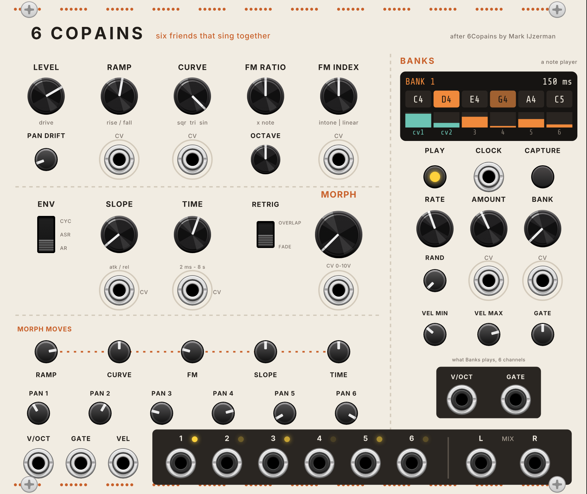

# 6 Copains

Six singing friends for VCV Rack 2. Each voice is a triangle that bends towards a square or a sine, with noisy FM and its own low-pass gate, in the spirit of Mannequins' Just Friends in synthesis mode. One **MORPH** knob moves the whole sound, and a built-in **Banks** player plays the six voices from banks of six notes.

It is a port of [6Copains](https://github.com/markijzerman/6copains) for the Expert Sleepers disting NT by Mark IJzerman, which in turn ports [nb_monamie](https://github.com/sonocircuit/nb_monamie) by sonoCircuit. The synthesis engine is 6Copains' own code, so it sounds the same as the NT version.

## Install

1. Download `SixCopains-2.2.0-mac-arm64.vcvplugin` from this repository's **Releases** page (the "latest" release).
2. Put it in `Documents/Rack2/plugins-mac-arm64/` and restart Rack. Rack unpacks it on start.
3. Find it in the module browser under **Haer > 6 Copains**.

## Quick start

**Let it play on its own**

1. Patch **L** and **R** into Audio (or a mixer).
2. Press **PLAY**. The display lights up as the six notes of bank 1 (C major pentatonic) fire at random, every 150 ms.
3. Turn **MORPH** slowly. Ramp, curve and FM all move together, so the voices change character while the notes keep coming.
4. Turn **BANK** to change the notes, **AMOUNT** for how busy it is, and **RATE** for how fast.

**Play it from MIDI (Live, the Hapax)**

1. Add VCV **MIDI-CV**, pick your MIDI input, and set its polyphony to 6 in its right-click menu.
2. Patch its **V/OCT** to **V/OCT**, **GATE** to **GATE** and **VEL** to **VEL** on 6 Copains.
3. Play chords. Each MIDI-CV channel plays its own voice. In the display those voices show as **cv1**, **cv2** and so on, in teal.

**Play a chord from one gate**

Patch a polyphonic V/OCT (for example a chord from a sequencer or a quantizer) and a *mono* gate. Every V/OCT channel plays on the same gate, as one chord.

## Controls

### Sound

| Control | What it does |
|---|---|
| **LEVEL** | Drive into each voice's soft clipper. Low is clean, high is warmer and louder. |
| **RAMP** | The triangle's shape: how much of each cycle is rising. Centre is a symmetrical triangle; the ends are saws. The tooltip shows rise/fall, e.g. 54/46. CV input below. |
| **CURVE** | Fully left is a square, centre a triangle, fully right a sine. CV input below. |
| **FM RATIO** | The FM modulator's pitch, as a multiple of the note (0.5 to 2). 1.01 gives a slow beat. |
| **FM INDEX** | FM depth, with noise that rises sharply near full. **Right of centre (all)**: every voice gets the same depth. **Left (by voice)**: depth rises with the voice number, from none on voice 1 to full on voice 6. CV input below. |
| **PAN DRIFT** | A random pan offset for each new note. |
| **OCTAVE** | Shifts every note by -3 to +3 octaves (also the Banks outputs). |

### Intone

**INTONE** (top right, with a CV input below) spreads the six voices apart, as on Just Friends. At centre every voice plays the note it's given. Turn right and voice *n* plays *n* times higher: voice 1 as played, voice 2 an octave up, voice 3 an octave and a fifth, and so on up the harmonic series. Turn left for the undertones: voice *n* plays at 1/*n*. In between, the spread is partial, so a slow CV into INTONE bends a chord apart and back. It retunes notes that are already sounding, and it applies to everything: CV voices, Banks and LFOs.

### Range: audio or LFO

The **RANGE** switch (under RETRIG) drops every voice 8 octaves. In **LFO** (up), C4 is about 1 Hz, and V/OCT still works at 1 V per octave, so +2 V is about 4 Hz and -3 V is one cycle every 8 seconds. Everything else still applies: RAMP, CURVE and FM shape the LFO, and MORPH moves it. Flipping the switch retunes the voices that are already playing.

- **Free-running:** with nothing in GATE and Banks stopped, the six voices run on their own at the V/OCT rate (about 1 Hz with V/OCT unpatched). Turn **INTONE** right and they spread to 1x, 2x ... 6x that rate; left, to 1x, 1/2x ... 1/6x. A polyphonic V/OCT sets each voice's rate instead. ENV on CYC adds a cycling envelope on top, as tremolo.
- **Gated:** with GATE patched, or Banks playing, each voice is an LFO that starts from zero on its gate and is shaped by the envelope. With Banks, that's six randomly retriggered modulation shapes.
- Use the voice outputs **1 to 6** for modulation. In LFO range they swing about +/-4 to 5 V at full velocity. The low-pass gate passes LFOs, but LEVEL and velocity set their depth.

### End triggers

The **END** output (bottom right) sends a short trigger when a voice's envelope reaches zero: at the end of an AR note, at the end of each ASR or cycle release, and at the bottom of every CYC cycle. It's polyphonic, one channel per voice, so use VCV **Split** to get the six triggers on separate cables.

Patch them back into 6 Copains or into other modules to make voices trigger each other. For example, Split the END triggers and Merge them back in a different order into **GATE**, so voice 1 ending starts voice 2, voice 2 starts voice 3 and so on (see "A self-playing ring" below). A chain like that keeps itself going and changes speed when you turn TIME or SLOPE.

### Scope

The scope draws each voice in its own lane, in the voice's colour, brighter when it's louder. In audio range it shows about 21 ms and holds the wave still. In LFO range it shows the last 2.7 seconds, scrolling.

### Envelope

Each note goes through a low-pass gate: the envelope opens the filter as well as the level, and velocity scales both, so soft notes are darker as well as quieter.

| Control | What it does |
|---|---|
| **ENV** (switch) | **AR** (down): attack then release, whatever the gate length. **ASR** (middle): holds while the gate is high. **CYC** (up): rises and falls over and over while the gate is high. |
| **SLOPE** | How TIME is split between attack and release. Fully left is a pluck, fully right a swell. CV input below. |
| **TIME** | Attack plus release, 2.6 ms to 8 s. CV input below. |
| **RETRIG** (switch) | What happens when a voice gets a new note. **FADE** (down): the old note fades out in 50 ms. **OVERLAP** (up): the old note rings on, up to 16 notes at once. |

### Morph

**MORPH** fades in the five **MORPH MOVES** amounts. At 0 they do nothing; fully clockwise they are added in full. So you set two sounds: the knobs on their own, and the knobs plus the amounts. MORPH goes between them. Its CV input takes 0 to 10 V.

| Amount | Moves | Default |
|---|---|---|
| **RAMP** | Ramp | +61 % |
| **CURVE** | Curve | 0 |
| **FM** | FM index | -51 % |
| **SLOPE** | Slope | 0 |
| **TIME** | Time, by up to 1 s | 0 |

All CV inputs work the same way: 10 V moves the full width of the knob, so +/-5 V sweeps from the knob's position to either end.

### Pans

**PAN 1** to **PAN 6** place each voice in the stereo mix. They start alternating left and right and get wider with the voice number, so successive notes fan out.

### Banks

A note player after Mark IJzerman's JF Banks. On every clock tick, each of the bank's six notes plays with a chance set by AMOUNT, at a random velocity.

| Control | What it does |
|---|---|
| **PLAY** | Start and stop. Stopping releases every note it holds. |
| **CLOCK** | Patch a clock here and each pulse is one tick. RATE is then ignored, and GATE is a share of the time between pulses. |
| **CAPTURE** | Stores the notes on the **V/OCT** input in the current bank. With fewer than six notes, the chord repeats an octave up to fill the bank. Hold a chord on the Hapax and press it. |
| **RATE** | Internal clock, 20 ms to 2 s per tick. |
| **RAND** | Each internal tick is up to this much early or late. |
| **AMOUNT** | The chance that each note plays on a tick. CV input below. |
| **BANK** | Which of the eight banks plays. CV input below: 1.25 V per bank, so 0 to 10 V covers all eight. |
| **VEL MIN / VEL MAX** | The random velocity range. Velocity sets brightness as well as level. |
| **GATE** | Note length, as a share of the tick. It matters in ASR and CYC; AR ignores it. |

Banks plays on the voices that the V/OCT/GATE inputs don't use. With nothing in GATE it has all six; with a 4-channel MIDI-CV it has voices 5 and 6.

**Editing bank notes:** right-click the module and open **Bank 1 notes** to **Bank 8 notes**. Each has six sliders, one per note, plus **Load a scale** and **Transpose** up or down a semitone. The eight starting banks are C major pentatonic, A minor pentatonic, D dorian, F lydian, E phrygian, whole tone, stacked fifths and a high pentatonic. **Reset all banks** puts them back. Banks are saved with the patch.

### Inputs and outputs

| Jack | |
|---|---|
| **V/OCT** | Polyphonic pitch, 1 V/octave, 0 V = C4. Channel 1 plays voice 1, and so on, up to 6. |
| **GATE** | Polyphonic gate (above 1 V on, below 0.5 V off). A mono gate is shared by every V/OCT channel. |
| **VEL** | Polyphonic velocity, 0 to 10 V. Unpatched means full velocity. |
| **1 to 6** | Each voice on its own, unpanned. A patched voice output leaves the L/R mix (switch this off in the right-click menu). The light shows the voice's envelope. |
| **L / R** | The stereo mix. With only L patched it's a mono mix. |
| **Banks V/OCT / GATE** | What the Banks player plays, as 6 channels, to drive other voices too. |
| **END** | End-of-envelope triggers, 6 channels (see above). |

### Right-click menu

- **Sample & hold pitch on each gate.** Off (default): pitch follows V/OCT while the gate is high, so glides from MIDI-CV work. On: pitch is taken once, when the gate rises.
- **Patched voice outputs leave the L/R mix.** On by default.
- **Bank notes**, as above.

## nb_monamie's three patches

Set these and leave the rest at default (double-click a knob to reset it).

| | default | soufflet | ciclette |
|---|---|---|---|
| RAMP | 54/46 | 76/24 | 50/50 |
| CURVE | sine | sqr 48 / tri 52 | tri 98 / sin 2 |
| FM RATIO | 1.01 | 0.97 | 1.50 |
| FM INDEX | 0 | 0 | by voice 5 % |
| PAN DRIFT | 12 % | 48 % | 48 % |
| ENV | AR | ASR | CYC |
| SLOPE | 3/97 | 67/33 | 15/85 |
| TIME | 0.21 s | 1.51 s | 0.26 s |
| Morph RAMP | +61 % | -24 % | +72 % |
| Morph CURVE | 0 | +59 % | 0 |
| Morph FM | -51 % | +20 % | -40 % |

## Patch ideas

**Six related LFOs.** RANGE on LFO, nothing in GATE, INTONE fully right. Voices 1 to 6 now run at 1x to 6x the same rate and line up again every second or so. Send them to filter cutoffs, Marbles' bias, or out through the disting NT to the modular. Turn FM INDEX left (by voice) and the faster ones get wobbly while voice 1 stays steady.

**A self-playing ring.** ENV on AR. Split the **END** output and Merge it back into **GATE** shifted by one voice, so END 1 feeds gate 2, END 2 feeds gate 3, and so on. For gate 1, mix END 6 with a slow clock or a button in a small mixer (VCV Mix), so you can kick the ring into life. Each voice ends and starts the next, round and round. Give SLOPE and TIME CV from a slow random and the ring speeds up and slows down, and a little INTONE turns it into an arpeggio.

**Self-steering chords (for arrangement).** Patch Banks with a 16th clock from Live (through the disting NT or VCV's MIDI > CLK). Send a slow random (or Live automation via CV Tools) into **MORPH**, and a slower stepped one into **BANK**. The notes stay in one bank for a while, then the harmony moves, so a loop changes over minutes without you touching it. Try AMOUNT around 25 %, ENV on CYC, GATE long.

**Detroit stabs.** ENV on AR, SLOPE fully left, TIME around 0.15 s, CURVE a little left of centre, FM INDEX right (all) at 20 %. Play chords from the Hapax through MIDI-CV. Raise MORPH on the breakdown with an envelope or Live automation.

**Six separate friends.** Patch voice outputs 1 to 6 into different effects (delay on 1, a reverb on 5 and 6), keep the rest in the L/R mix. FM INDEX turned left (by voice) makes the higher voices grittier, so voices 5 and 6 behave like a separate part.

**Banks driving hardware.** Patch **Banks V/OCT** and **GATE** into a split (VCV Split) and out through the disting NT to Just Friends, Three Sisters or Mangrove, so the hardware plays the same notes as the module.

## How it differs from 6Copains on the disting NT

- **0 V = C4**, as in VCV. The NT version uses 0 V = C3.
- **One gate per voice.** The NT has one gate for all CV voices; here a polyphonic GATE cable gives each voice its own, and a mono gate still plays a chord.
- **Separate voice outputs** with voice lights, and a display.
- **Banks is built in**, with a CLOCK input, CV for AMOUNT and BANK, chord CAPTURE, and polyphonic outputs. On the NT it is a separate Lua script.
- No direct MIDI, sustain or pitch bend: use VCV's MIDI-CV for those.
- **RANGE** switch for LFO rates, with free-running voices, an **INTONE** control, **END** triggers and a **scope**. None of these are in the NT version.
- Output level is the NT's default +6 dB: one full-velocity voice peaks around 2.3 V on its own output.

## Building

The GitHub Action builds the Mac (Apple Silicon) plugin on every push to `main` and puts it on the "latest" release. To build by hand: `make dist RACK_DIR=path/to/Rack-SDK`. The engine tests run without Rack: `c++ -std=c++11 -O2 -o test/engine_test test/engine_test.cpp && test/engine_test`. The panel is drawn by `python3 res/make_panel.py` (needs `pip install fonttools` and the Inter font).

## Credits and licence

- **[6Copains](https://github.com/markijzerman/6copains)** for the disting NT, and the 6Copains Banks / JF Banks note player: Mark IJzerman. GPL-3.0. The synthesis engine in `src/CopainsEngine.hpp` is his, with the VCV changes marked "VCV:".
- **[nb_monamie](https://github.com/sonocircuit/nb_monamie)** (monami.e), the norns voice 6Copains ports: [sonoCircuit](https://github.com/sonocircuit). GPL-3.0.
- **[Imaginary Friends](https://github.com/monome-community/exquisite-script/blob/master/lib/Engine_ImaginaryFriends.sc)**, the SuperCollider engine whose waveshaping nb_monamie uses: [@synthetivv](https://llllllll.co/u/synthetivv).
- **Just Friends** is a module by Mannequins (Whimsical Raps). 6 Copains is an unofficial approximation and isn't affiliated with them.
- VCV Rack port: Haer.

Licensed under the GNU General Public License v3.0 or later (see `LICENSE.txt` and `LICENSE-GPL-3.0.txt`), as a derivative of 6Copains and nb_monamie.
